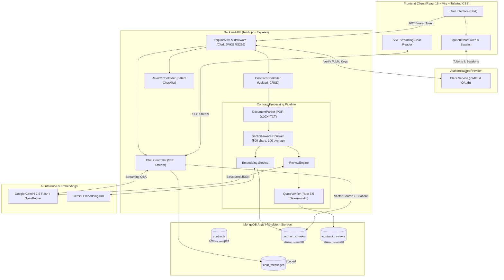

# AI Contract Review Assistant

An evidence-grounded, full-stack AI contract review platform built strictly in accordance with legal verification and multi-tenant security standards.

Signed-in users can upload legal contracts in **PDF**, **DOCX**, or **TXT** format (up to 20 MB). The system extracts the text, preserves page and section references, partitions content into semantic chunks, and generates evidence-grounded reviews against a fixed 8-item legal checklist with backend quote verification and interactive streaming follow-up chat.

---

## 🌐 Live Deployments

- **Live Frontend (Vercel)**: **[https://ai-contract-review-jade.vercel.app](https://ai-contract-review-jade.vercel.app)**
- **Live Backend API (Render)**: **[https://ai-contract-review-pwy5.onrender.com](https://ai-contract-review-pwy5.onrender.com)**
- **API Health Check**: **[https://ai-contract-review-pwy5.onrender.com/api/health](https://ai-contract-review-pwy5.onrender.com/api/health)**

---

## 📐 Architecture Diagram & System Description

### Architecture Diagram



### Architecture Narrative
1. **User Authentication**: Users sign up and sign in using Clerk. The frontend receives an RS256-signed JWT token.
2. **Contract Upload**: The user uploads a PDF, DOCX, or TXT file. The Express backend validates file type and size (<= 20 MB), saves the file with a UUID key, and immediately returns `202 Accepted` to keep the UI non-blocking.
3. **Extraction & Chunking**: The asynchronous pipeline parses text, preserves page numbers, and divides content into 800-character section-aware chunks with 100-character overlap.
4. **Vector Embeddings & Storage**: Chunks are embedded and stored directly in MongoDB, indexed by `{ ownerId, contractId }`.
5. **Grounded 8-Item Checklist Review**: The review engine analyzes the contract against 8 fixed checklist items.
6. **Deterministic Quote Verification (Rule 6.5)**: Every extracted quote candidate is strictly validated character-for-character against the raw contract text. If verbatim verification fails, the item is downgraded to `unclear` and the quote is cleared.
7. **Streaming Chat**: Users ask follow-up questions. Top matching chunks are retrieved via scoped vector search, and Gemini streams responses via Server-Sent Events (SSE) with verified citations.

---

## 🏗️ Technology Stack & Why Chosen

| Component | Technology | Why We Chose It |
|---|---|---|
| **Frontend Framework** | **React 18 + Vite** | Instant HMR during development, fast single-page app (SPA) performance, and native component model for split-screen contract review. |
| **Styling** | **Tailwind CSS** | Utility-first styling enabling clean legal typography, responsive layouts, color-coded status badges, and accessible modal views. |
| **Authentication** | **Clerk (`@clerk/react`, `@clerk/express`, JWKS)** | Production-grade authentication with Google OAuth, email/password, session rotation, and cryptographic JWKS token verification without building custom auth infrastructure. |
| **Backend Server** | **Node.js + Express.js** | Non-blocking asynchronous event loop, native Server-Sent Events (SSE) streaming support for real-time chat, and robust middleware ecosystem. |
| **Database** | **MongoDB Atlas + Mongoose** | Flexible document model for storing nested review findings, variable-length chunks, and chat history. Native replica set support and built-in persistent WiredTiger engine fallback for offline resilience. |
| **Vector Search** | **Atlas Vector Search & Cosine Similarity** | Scoped vector indexing directly in MongoDB with an in-memory cosine similarity fallback, ensuring seamless search across local and cloud environments. |
| **AI Inference** | **Google Gemini 2.5 Flash / OpenRouter** | High token throughput, cost efficiency, huge context window, and native JSON structured output mode for guaranteed schema adherence. |
| **Vector Embeddings** | **`gemini-embedding-001`** | High-dimensional semantic embeddings (3072 dimensions) providing accurate retrieval for legal terminology. |
| **Document Parsers** | **`pdf-parse`, `mammoth`** | Lightweight, zero-native-dependency libraries for extracting text, page breaks, and headings from PDF and Word documents. |

---

## 🔑 Setup Guide & Environment Variables

### 1. How to Create the Clerk Application
1. Visit **[Clerk Dashboard](https://dashboard.clerk.com)** and sign in.
2. Click **Create Application**.
3. Enter an application name (e.g. `AI Contract Review`).
4. Select authentication methods: **Email** and **Google**.
5. Under **User & Authentication** > **Password**, set **Minimum length** to `8`.
6. Navigate to **API Keys** in the sidebar:
   - Copy **Publishable key** (`pk_test_...` or `pk_live_...`).
   - Copy **Secret key** (`sk_test_...` or `sk_live_...`).

---

### 2. How to Obtain the AI API Keys

#### Option A: Google Gemini API (Default)
1. Go to **[Google AI Studio](https://aistudio.google.com)**.
2. Click **Get API Key** and create a free key.
3. Copy the key (starts with `AIzaSy...` or `AQ...`).

#### Option B: OpenRouter API
1. Go to **[OpenRouter Keys](https://openrouter.ai/keys)**.
2. Create an account and click **Create Key**.
3. Copy your OpenRouter API key (`sk-or-v1-...`).
4. OpenRouter can be used as an alternative OpenAI-compatible endpoint by supplying `OPENROUTER_API_KEY`.

---

### 3. Which Keys Go Where

| Variable Name | Description | Where It Goes |
|---|---|---|
| `PORT` | Backend server port (`5000`) | Root `.env`, `server/.env`, Render Dashboard |
| `CLIENT_URL` | Frontend origin URL (`http://localhost:3000` or `https://ai-contract-review-jade.vercel.app`) | Root `.env`, `server/.env`, Render Dashboard |
| `MONGODB_URI` | MongoDB connection string (Atlas or `mongodb://localhost:27017/contract_review`) | Root `.env`, `server/.env`, Render Dashboard |
| `CLERK_SECRET_KEY` | Clerk backend secret key (`sk_test_...`) | Root `.env`, `server/.env`, Render Dashboard |
| `CLERK_PUBLISHABLE_KEY` | Clerk backend publishable key (`pk_test_...`) | Root `.env`, `server/.env`, Render Dashboard |
| `VITE_CLERK_PUBLISHABLE_KEY` | Clerk frontend publishable key (`pk_test_...`) | Root `.env`, `client/.env`, Vercel Project Settings |
| `VITE_API_URL` | Backend API base URL (`https://ai-contract-review-pwy5.onrender.com/api` or `http://localhost:5000/api`) | Root `.env`, `client/.env`, Vercel Project Settings |
| `GEMINI_API_KEY` | Google Gemini API key (`AIzaSy...`) | Root `.env`, `server/.env`, Render Dashboard |
| `GEMINI_CHAT_MODEL` | Chat model (`gemini-2.5-flash`) | Root `.env`, `server/.env`, Render Dashboard |
| `GEMINI_EMBEDDING_MODEL` | Embedding model (`gemini-embedding-001`) | Root `.env`, `server/.env`, Render Dashboard |
| `OPENROUTER_API_KEY` | Optional OpenRouter API key (`sk-or-v1-...`) | Root `.env`, `server/.env`, Render Dashboard |
| `DEV_MOCK_AUTH` | Mock auth flag (`false` for production) | Root `.env`, `server/.env`, Render Dashboard |

---

## 🚀 How to Run Locally

### Prerequisites
- **Node.js**: `v18.0.0` or higher (`node -v`)
- **npm**: `v9.0.0` or higher (`npm -v`)
- **MongoDB**: Either local MongoDB (`mongodb://127.0.0.1:27017`), MongoDB Atlas URI, or Docker.

### Step 1: Clone Repository
```bash
git clone https://github.com/Nitish567478/AI-Contract-Review.git
cd AI-Contract-Review
```

### Step 2: Configure Environment Variables
Copy `.env.example` to `.env`:
```bash
cp .env.example .env
```
Fill in your `CLERK_PUBLISHABLE_KEY`, `CLERK_SECRET_KEY`, `MONGODB_URI`, and `GEMINI_API_KEY`.

### Step 3: Install Dependencies
```bash
# Install backend dependencies
cd server
npm install
cd ..

# Install frontend dependencies
cd client
npm install
cd ..
```

### Step 4: Start Backend Server
```bash
cd server
npm run dev
```
Backend runs on **`http://localhost:5000`** (Health check: `http://localhost:5000/api/health`).

### Step 5: Start Frontend Client
In a second terminal:
```bash
cd client
npm run dev
```
Frontend runs on **`http://localhost:3000`**.

---

## ☁️ Deploying to Production

### 1. Backend Deployment (Render)
1. Link your GitHub repository in **[Render](https://render.com)** as a **Web Service**.
2. Settings:
   - **Root Directory**: `server`
   - **Build Command**: `npm install`
   - **Start Command**: `node src/server.js`
3. Environment Variables:
   - Add `PORT`, `CLIENT_URL`, `MONGODB_URI`, `CLERK_SECRET_KEY`, `CLERK_PUBLISHABLE_KEY`, `GEMINI_API_KEY`, `GEMINI_CHAT_MODEL`, `GEMINI_EMBEDDING_MODEL`.

### 2. Frontend Deployment (Vercel)
1. Import your GitHub repository into **[Vercel](https://vercel.com)**.
2. Settings:
   - **Framework Preset**: `Vite`
   - **Root Directory**: `client`
3. Environment Variables:
   - `VITE_CLERK_PUBLISHABLE_KEY`: `pk_test_...`
   - `VITE_API_URL`: `https://ai-contract-review-pwy5.onrender.com/api`
4. **SPA 404 Prevention**: `vercel.json` rewrite configuration (`/(.*) -> /index.html`) is pre-configured in both root and `client/` directories, preventing 404 errors on direct sub-route visits like `/sign-in/factor-one` and `/dashboard`.

---

## 📋 Fixed 8-Item Legal Review Checklist

Every contract is reviewed against 8 categories:
1. **`parties`**: Contracting entities and formal legal roles.
2. **`start_date_and_term`**: Effective date, duration, expiry, and agreement term.
3. **`payment_terms`**: Invoicing schedules, amounts, currency, and Net payment terms.
4. **`termination`**: Notice windows, termination for cause, and termination for convenience.
5. **`limitation_of_liability`**: Liability caps, aggregate damages limits, and excluded claims.
6. **`confidentiality`**: Disclosure restrictions and obligation survival duration.
7. **`governing_law`**: Applicable state/country law and dispute resolution jurisdiction.
8. **`auto_renewal`**: Automatic extension provisions and cancellation notice windows.

---

## 🔍 Chunking & Retrieval Choices for Each Checklist Item

### Chunking Strategy
- **Size & Overlap**: 800 characters per chunk with 100 characters of trailing overlap.
- **Section & Heading Awareness**: The chunker detects article boundaries (e.g. `Section 1. Term`, `ARTICLE IV`, `1. Parties`) and assigns explicit section headings and page numbers to each chunk.
- **Why**: Legal provisions typically span 1 to 3 sentences. Very large chunks (e.g. 2,000+ words) dilute semantic vector representations, while microscopic chunks (50 words) sever crucial conditional clauses. Bounded chunks preserve sentence continuity across page boundaries.

### Checklist-Specific Retrieval Mapping

| Checklist Item | Target Section & Keyword Focus | Retrieval Strategy |
|---|---|---|
| **Parties** | Preamble, Recitals, Introduction, Signature block | Keyword scan for `by and between`, `Parties`, `Customer`, `Service Provider` combined with preamble chunk ranking. |
| **Start Date & Term** | `Effective Date`, `Commencement`, `Term`, `Duration` | Semantic embedding match prioritizing initial chunks and section headers matching `Term`. |
| **Payment Terms** | `Fees`, `Invoicing`, `Payment Schedule`, `Net 30`, `Taxes` | Hybrid search on currency symbols (`$`), `due and payable`, `Net`, and fee structures. |
| **Termination** | `Termination`, `Default`, `Breach`, `Cure period`, `Convenience` | Semantic search targeting clauses containing notice requirements (`prior written notice`, `material breach`). |
| **Limitation of Liability** | `Liability`, `Consequential damages`, `Cap`, `Aggregate` | Targeted retrieval on damage exclusion language (`indirect, incidental, punitive`) and liability multipliers. |
| **Confidentiality** | `Confidential Information`, `Non-Disclosure`, `Survival` | High semantic similarity against disclosure obligations and post-termination survival clauses. |
| **Governing Law** | `Governing Law`, `Jurisdiction`, `Venue`, `Courts` | Targeted scan for geographical identifiers, state names, and choice-of-law provisions. |
| **Auto-Renewal** | `Renewal`, `Extension`, `Successive terms`, `Opt-out` | Proximity scan combining `automatically renew` and opt-out notice windows. |

---

## 🛡️ How We Check That Quotes Are Real (Rule 6.5)

To prevent AI hallucinations, quote verification is enforced strictly on the backend via `QuoteVerifier`:

1. **Whitespace & Typographic Normalization**:
   - Collapses consecutive whitespace and newline characters.
   - Normalizes typographic curly quotes (`“ ” ‘ ’`) and dashes (`– —`) into standard ASCII characters.
2. **Exact Verbatim Containment Check**:
   - Compares the candidate quote string character-for-character against the raw extracted contract chunks and source document text.
   - Fuzzy matching or word approximations are strictly forbidden.
3. **Automated Verbatim Quote Recovery**:
   - If an LLM response indicates that a clause was found but paraphrases words or omits punctuation, the engine automatically extracts the exact verbatim passage directly from the source contract chunk and re-verifies it.
4. **Mandatory Rule 6.5.5 Downgrade**:
   - If a quote cannot be verified verbatim against the source contract text, the finding status is automatically downgraded to **`unclear`**, the quote and location are cleared to `null`, and `needsAttention: true` is flagged. **Invented quotes are never presented as verified evidence.**

---

## 🔒 How User Data Is Kept Separate (Multi-Tenant Isolation)

User data separation is enforced cryptographically and at the database layer:

1. **Token-Derived Identity**:
   - User identity (`req.auth.userId`) is derived exclusively from the verified Clerk session token (`sub` claim) using Clerk's public JWKS keys.
   - The API never accepts or trusts an untrusted user ID passed via query parameters or body payloads.
2. **Query Scoping**:
   - Every database query across all collections is scoped to the authenticated user:
     ```javascript
     const contracts = await Contract.find({ ownerId: req.auth.userId });
     const review = await ContractReview.findOne({ contractId, ownerId: req.auth.userId });
     ```
3. **Cross-Tenant Access Denial**:
   - If User B attempts to access or delete User A's contract by guessing the contract ID, the query returns `404 Not Found`.
4. **Scoped Vector Retrieval**:
   - Vector search filters explicitly require `{ ownerId: req.auth.userId, contractId: targetContractId }`, preventing embeddings of other users or unrelated contracts from being returned.
5. **Cascading Deletions**:
   - Deleting a contract permanently deletes all associated chunks, review findings, and chat messages scoped strictly to `{ contractId, ownerId: req.auth.userId }`.
6. **Automated Verification**:
   - Multi-tenant security is continuously verified by [tests/isolation.test.js](file:///c:/Users/HP/OneDrive/Desktop/Contract%20review%20assistant/tests/isolation.test.js).

---

## 🧪 Test Suite & Accuracy Benchmark Results

Run all test suites locally:
```bash
node --test tests/quote_verifier.test.js tests/isolation.test.js tests/api_contracts.test.js
node tests/evaluate.js
```

### Benchmark Results
```text
===========================================================================
        CONTRACT REVIEW ASSISTANT - ACCURACY EVALUATION BENCHMARK          
         Testing Grounded Checklist Pipeline Against Ground Truth          
===========================================================================

EVALUATING: Mutual Non-Disclosure Agreement (NDA) (contract_nda.txt)
---------------------------------------------------------------------------
Checklist Item            | Expected   | Actual     | Result | Quote Verified
---------------------------------------------------------------------------
Parties                   | found      | found      | PASS   | Verified (100%)
Start date and term       | found      | found      | PASS   | Verified (100%)
Payment terms             | not_found  | not_found  | PASS   | N/A
Termination               | found      | found      | PASS   | Verified (100%)
Limitation of liability   | found      | found      | PASS   | Verified (100%)
Confidentiality           | found      | found      | PASS   | Verified (100%)
Governing law             | found      | found      | PASS   | Verified (100%)
Auto-renewal              | not_found  | not_found  | PASS   | N/A
---------------------------------------------------------------------------

EVALUATING: Master Services Agreement (SaaS MSA) (contract_saas_msa.txt)
---------------------------------------------------------------------------
Checklist Item            | Expected   | Actual     | Result | Quote Verified
---------------------------------------------------------------------------
Parties                   | found      | found      | PASS   | Verified (100%)
Start date and term       | found      | found      | PASS   | Verified (100%)
Payment terms             | found      | found      | PASS   | Verified (100%)
Termination               | found      | found      | PASS   | Verified (100%)
Limitation of liability   | found      | found      | PASS   | Verified (100%)
Confidentiality           | found      | found      | PASS   | Verified (100%)
Governing law             | found      | found      | PASS   | Verified (100%)
Auto-renewal              | found      | found      | PASS   | Verified (100%)
---------------------------------------------------------------------------

===========================================================================
OVERALL BENCHMARK ACCURACY : 16/16 items correct (100.0%)
OVERALL QUOTE VERIFICATION : 14/14 quotes verified (100.0%)
===========================================================================
```

---

## ⚠️ Known Limitations & Future Improvements

### Current Limitations
1. **Scanned Image PDFs**: Documents containing scanned images without embedded text streams require optical character recognition (OCR) before text can be extracted.
2. **Complex Table Parsing**: Multi-column tables in Word and PDF are extracted as linearized plain text.
3. **Single Contract Focus**: The platform reviews one contract at a time rather than comparing multiple contract versions side-by-side.

### Improvements with More Time
1. **Integrated OCR Engine**: Add Google Cloud Vision or Tesseract OCR for scanned PDF uploads.
2. **Custom Legal Playbooks**: Allow legal teams to define custom checklist items, unacceptable clauses, and risk severity weights.
3. **Contract Redlining & Diffing**: Automatically generate track-changes redlines comparing vendor contracts against company standard fallback clauses.
4. **Audit Report Export**: One-click PDF and Word export of review findings, verbatim citations, and risk summaries.

---

## 🤖 How AI Tools Were Used

| AI Tool / Model | Primary Purpose & Usage |
|---|---|
| **Google Gemini 2.5 Flash** | Core inference engine for analyzing contract text against the 8-item legal checklist using structured JSON schema output and powering low-latency Server-Sent Events (SSE) streaming chat. |
| **`gemini-embedding-001`** | Vector embedding generator creating 3072-dimensional vector representations for semantic document chunking and vector search retrieval. |
| **Antigravity AI Assistant** | Full-stack scaffolding, architectural design, Clerk SDK v6 migration, Rule 6.5 quote verification engine implementation, automated evaluation benchmark creation, test suite authoring, and Vercel/Render deployment configuration. |

---

## 📂 Repository Structure

```
AI-Contract-Review/
├── client/                     # Frontend SPA (React 18 + Vite + Tailwind CSS)
│   ├── src/
│   │   ├── api/                # API client with token injection & SSE reader
│   │   ├── components/         # AppLayout, ProtectedRoute, Modals
│   │   ├── features/           # Chat, Contracts, Review components
│   │   ├── pages/              # LandingPage, DashboardPage, ReviewPage, SignIn/SignUp
│   │   ├── App.jsx             # React Router & Clerk Provider setup
│   │   └── main.jsx            # Application entrypoint
│   ├── vercel.json             # Vercel SPA routing rewrite rules
│   ├── vite.config.js          # Vite build config
│   └── tailwind.config.js      # Tailwind styling rules
├── server/                     # Backend API (Node.js + Express + Mongoose)
│   ├── src/
│   │   ├── config/             # Database connection & env variables
│   │   ├── controllers/        # Contract, Review, and Chat controllers
│   │   ├── middleware/         # requireAuth (Clerk JWKS), errorHandler
│   │   ├── models/             # Mongoose schemas (Contract, Chunk, Review, Chat)
│   │   ├── routes/             # Express API routes
│   │   ├── services/           # Gemini, Chunker, DocumentParser, QuoteVerifier
│   │   ├── jobs/               # Background contract processing queue
│   │   ├── app.js              # Express app & CORS configuration
│   │   └── server.js           # Server bootstrap
│   └── Dockerfile              # Container specification
├── tests/                      # Automated test suites
│   ├── quote_verifier.test.js  # Rule 6.5 quote verification tests
│   ├── isolation.test.js       # Multi-tenant user isolation tests
│   └── evaluate.js             # Ground truth accuracy benchmark
├── vercel.json                 # Root Vercel SPA routing configuration
├── .env.example                # Documented environment template
├── .gitignore                  # Git ignore rules
└── README.md                   # Comprehensive documentation
```
